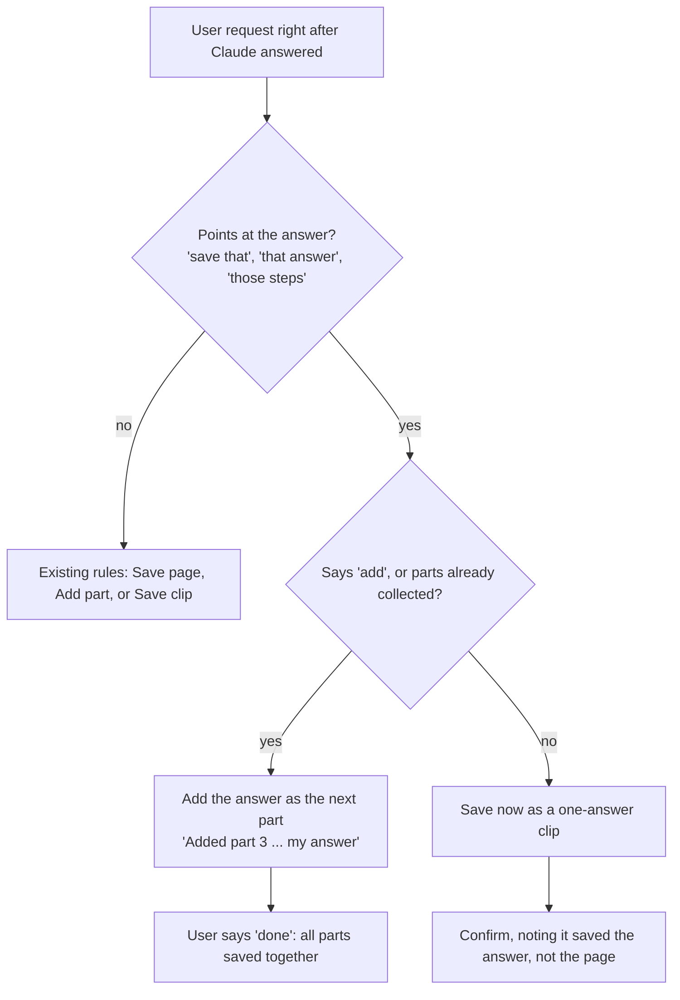

## At a glance

8 changes · 4 files · 10 decisions · 5 open items

Gleaner can now keep the answers Claude gives about a page, not just the page itself. Ask a question while reading docs, get a clarification or a list of steps, then say "save that" and the answer becomes a clip. The work is open for review as PR #5 (`claude/skill-page-questions-f17a91` into `main`). It passes every automated check, but it is not versioned and not tested live.

## What changed

### Save an answer you just got

- **Affects:** users.
- **Now:** "save that", "save that answer", "save those steps", or "save what you just told me" saves Claude's most recent answer (or the one named) as its own clip. A bare "save that" right after an answer means the answer even if text is highlighted, and that highlight isn't added later at "done". The confirmation says so: "Saved my answer — say 'save the page' if you meant the whole page." "Explain the auth flow and save it" answers first, then saves, even if the request also says "this page" or "save them".
- **Reach it:** plain language in the Chrome side panel or the Claude Code desktop browser; new **Save answer** row in the Intents table of `plugins/gleaner/skills/clip/SKILL.md`.

### Add an answer to a clip you're collecting

- **Affects:** users.
- **Now:** while parts are being collected, an answer is added as the next part instead of being saved alone, and the confirmation is the "Added part" line naming it as Claude's answer. "Done" saves everything together. "Add that answer" starts or extends a collection. "Save our back-and-forth about X" adds one part per question and answer.
- **Reach it:** new first source in "Collecting parts" in `SKILL.md`.

### Answers are kept as given, with the question as the heading

- **Affects:** users, and anyone reading clips later.
- **Now:** an answer part is headed by the user's question and keeps the answer word for word, so numbered steps and code survive. Its source line reads "Answer about (page link)", or "Answer, not tied to a page" for a general question. Anything that didn't come from the page is marked "(not from the page)". A clip holding a single answer skips the TL;DR.
- **Reach it:** new "Answer parts" rule in step 3 of `SKILL.md`.

### Answers are counted in a clip's scope and in the index

- **Affects:** users.
- **Now:** the **Scope** line counts answers apart from other parts, such as `2 parts, 1 answer from 1 page`, or `1 answer, no page`, and the clip index marks titles the same way. Only a clip with no page behind it drops the Source line and uses the Type `other`. In Notion, a clip without a TL;DR starts its page body at Parts.
- **Reach it:** step 3 rules, the Notion steps, and "Clip index" step 3 in `SKILL.md`.

### Answers from an earlier session are refused, not rebuilt

- **Affects:** users.
- **Now:** if the answer is no longer in the conversation, Gleaner says it can't see it and offers to answer again, rather than recreating it from memory and saving that as the original.
- **Reach it:** new item in "Edge cases" in `SKILL.md`.

### Answers save without a browser

- **Affects:** users.
- **Now:** saving an answer doesn't need a page open, so it works in Claude Code with no browser tools. Page saves still ask for a browser or a URL.
- **Reach it:** "No browser at all" in "Where Gleaner runs" in `SKILL.md`.

### Answers about YouTube videos follow the same rules

- **Affects:** users.
- **Now:** an answer about a video keeps the answer-part format: headed by the question with no time link, linking the video's canonical watch URL, with any timestamps in the answer linked to the second and taken from the transcript.
- **Reach it:** the part clip rule in `plugins/gleaner/skills/youtube/SKILL.md`.

### The README and the skills guide document the feature

- **Affects:** users and teammates.
- **Now:** the README has a "Saving answers" section, a features bullet, a cheat-sheet row, a "How Gleaner decides" rule, a note under "What a clip looks like", and the updated index-count wording. The skills guide has a "Save an answer" section.
- **Reach it:** `README.md` under Usage guide, and `plugins/gleaner/skills/README.md`.

## How it works now

How a request after an answer is routed. The only new branch is "points at the answer"; everything on the "no" side behaves exactly as before.

## Before and after

| Before | After |
|---|---|
| Gleaner could save a page, a highlight, a described section, or pasted text. | It can also save an answer Claude gave about the page. |
| "Save that" after an answer fell through to the page rules and saved the page. | "Save that" right after an answer saves the answer, and the confirmation says so. |
| "Save this" after an answer saved the page silently. | It still saves the page, but the confirmation mentions that "save that answer" saves the answer instead. |
| "Done" added any highlight not yet added. | A highlight passed over for an answer isn't added at "done". |
| Every part was squeezed into 2–4 bullets and about 150 words. | Answer parts are kept as given; those limits don't apply to them. |
| A part's heading was the user's note or topic. | An answer part's heading is the user's question. |
| Nothing marked content that didn't come from the source. | Anything in an answer not from the page is marked "(not from the page)". |
| Scope read `3 parts from 2 pages`. | Answers are counted separately: `2 parts, 1 answer from 1 page`, or `1 answer, no page`. |
| A part clip always had a TL;DR. | A clip of a single answer skips it. |
| A clip always had a Source line. | An answer to a general question with no page has none, and its Type is `other`. |
| With no browser, Gleaner asked for a page. | Saving an answer works with no browser. |

## Decisions

### Extend the `clip` skill instead of adding a new skill

- **Why:** Claude already answers questions about a page without any skill; the only new behavior is saving the answer. The text is already in the conversation, so nothing new has to be extracted.
- **Rejected:** a separate "ask" or "Q&A" skill. It would compete with `clip` for "save that" and duplicate all of its destination and save logic. The `youtube` skill earned its own file only because it needs transcript extraction.

### Treat an answer as a kind of part, not a new clip format

- **Why:** one format means the destinations, duplicate check, categories, Notion fields, and index all work unchanged. A single saved answer is just a part clip with one part.
- **Rejected:** a separate "answer clip" template, which would need its own rules in every one of those places.

### A bare "save that" right after an answer saves the answer

- **Why:** the user's decision. It matches the skill's existing "act, then say what you assumed" rule, and the confirmation offers "save the page" as the correction.
- **Rejected:** asking every time, which adds a round trip to the most common case.

### Leave "save this" behavior alone

- **Why:** "save this" is the skill's core page-and-highlight intent, and changing it would affect far more requests. The confirmation now points at "save that answer" instead.
- **Rejected:** making "save this" also mean the answer.

### Mid-collection, "save that answer" adds a part rather than saving everything

- **Why:** saving early would clear the collection while the user may still be adding to it; one extra "done" is the cheaper mistake.
- **Rejected:** mirroring Save clip, which saves all parts at once.

### Keep answers as given instead of summarizing them

- **Why:** the 2–4 bullet, 150-word part limit would wreck a numbered step list, which is one of the main things users asked to keep.
- **Rejected:** summarizing answers like any other part.

### Mark anything not from the page

- **Why:** clips are used later as research notes. Mixing Claude's background knowledge in with what the source said, unlabeled, is the main way this feature could mislead.
- **Rejected:** saving answers unlabeled, as if they were page content.

### No new Type value and no auto-save

- **Why:** the Scope line already tells answers apart, so a new Type adds nothing to search. Clips are never overwritten, so saving every answer automatically would flood the folder.
- **Rejected:** a "Q&A" Type, which would need a change to the Notion database's select options; auto-capturing every answer.

### Leave the version bump and changelog to the `release` skill

- **Why:** the project's `CLAUDE.md` says to cut versions with `/release`, and that skill can only be run by the user. It also commits, so it finishes this work in one step.
- **Rejected:** bumping `plugin.json` and writing the changelog entry by hand in this change, which was the original proposal.

### Put the YouTube answer rules in the youtube skill

- **Why:** the youtube skill's summary section replaces the clip skill's step 3 outright, so answer rules that lived only in the clip skill would never reach video pages. A pre-PR review caught this, and the clip skill now points to the youtube skill's rule.
- **Rejected:** keeping the rule only in the clip skill, the first version, chosen because the change was scoped to the clip skill.

## Learnings

- **The release skill is user-only.** `.claude/skills/release/SKILL.md` sets `disable-model-invocation: true`, so Claude cannot bump the version itself. The plan to bump in this change was dropped after reading it.
- **The youtube skill replaces the clip skill's step 3.** A rule added only to the clip skill's step 3 silently doesn't apply on video pages; video-specific rules have to live in `youtube/SKILL.md`.
- **CI lints every Markdown file.** `.markdownlint-cli2.jsonc` globs `**/*.md`, so new Markdown anywhere in the repo, including this recap record, must pass markdownlint.
- **Plugin validation doesn't check frontmatter YAML.** The two `claude plugin validate` runs pass even with broken frontmatter, so a separate Ruby YAML parse was run. The new description measured 803 characters against the 1024 limit.
- **A frontmatter `title:` counts as the page heading.** Markdownlint's single-heading rule (MD025) flagged this record for having both a `title:` and a top-level `#` heading, so the record carries the title only in frontmatter.
- **Main moved during the work.** A skills usage guide landed on `main` mid-session; after syncing, it needed its own "Save an answer" section.
- Nothing else was tried and abandoned.

## Open items

1. **Version before merge.** Run `/release minor` on the PR #5 branch to set 1.7.0, add the README changelog entry, validate, and commit.
2. **Live testing.** Not done; the maintainer tests against Chrome, Drive, Notion, and Cowork. Worth trying: "save that" after an answer with text highlighted; "save that answer" mid-collection; an answer mixing page content with background knowledge; a general question with no page saved to Notion (no Source); an answer about a YouTube video with timestamps.
3. **Marketing descriptions don't mention answers.** The `plugin.json` description, the `marketplace.json` description, and the README intro still list pages, parts, and videos only. The four-place sync rule covers destinations and surfaces, so it doesn't require an update, but the feature is invisible there.
4. **Pre-existing Notion schema wording.** The Notion property table in `SKILL.md` lists Scope values as `selection` or `N parts from M pages`, which no current template produces. It was not touched.
5. **Review items left as is.** "Save it" or "keep it" after an answer still follows the existing routing rules; the skills guide heading "clip: pages and parts" is unchanged; the generated gallery index at `docs/artifacts/index.html` links to sibling galleries that don't exist in this repo.

## Files touched

### Skills

- `plugins/gleaner/skills/clip/SKILL.md` — new Save answer intent and routing rules, answers as the first part source, the answer-part format, Scope and index counts, answers without a browser, the Notion body start, the earlier-session edge case, and new trigger phrases in the frontmatter description.
- `plugins/gleaner/skills/youtube/SKILL.md` — how answer parts look on a video, since this skill replaces the clip skill's step 3.

### Docs

- `README.md` — "Saving answers" section and contents link, features bullet, cheat-sheet row, "How Gleaner decides" rule, answer note under "What a clip looks like", and index-count wording.
- `plugins/gleaner/skills/README.md` — answers in the clip row and a "Save an answer" section.

### Repo

- `.gitignore` — keeps the local `.claude/artifacts/` inbox out of git.

### This recap

- `docs/plans/sessions/add-answer-clips-session.md` — this record, which holds the published link for later republishes.
- `docs/artifacts/team-recap-2026-10-16.html` and `docs/artifacts/index.html` — the recap's gallery copy and the generated gallery index.

## Glossary

- **Gleaner** — a Claude plugin that saves what you read as summarized, tagged clips.
- **Clip** — one saved note: a summary with source, date, category, type, and tags.
- **Skill** — a Markdown instruction file Claude reads at runtime; Gleaner's are `clip` and `youtube`.
- **`clip` skill** — `plugins/gleaner/skills/clip/SKILL.md`, which holds all of Gleaner's saving behavior.
- **`youtube` skill** — the video-specific skill, which reads the clip skill first and changes only what differs for video.
- **Intent** — what a request is asking for, such as Save page, Add part, or the new Save answer.
- **Part** — one piece of a clip being collected: a highlight, a described section, pasted text, or now an answer.
- **Part clip** — a clip built from collected parts, each under its own heading.
- **Answer part** — a part whose text is Claude's answer and whose heading is the user's question.
- **Scope** — the clip header line that counts its parts, answers, and pages.
- **Type** — the kind of source page, such as docs, article, or video.
- **Clip index** — the table Gleaner returns when asked what was saved.
- **Frontmatter** — the YAML block at the top of a skill file; its `description` decides when the skill triggers.
- **Four-place sync rule** — the repo rule that the destination and surface list must match in four descriptions.
- **`/release`** — the project command that bumps the version, writes the changelog, validates, and commits.
- **Markdownlint** — the Markdown style checker CI runs on every `.md` file.
- **Chrome side panel** — Claude's panel inside Chrome, where Gleaner reads the open tab.
- **Claude Code desktop browser** — the built-in browser pane in the Claude Code desktop app.
- **Notion** — a notes app; Gleaner can save each clip as a page in a Notion database.
- **TL;DR** — the 2–3 sentence summary at the top of a clip.
- **PR #5** — the pull request on GitHub that carries this work for review.
