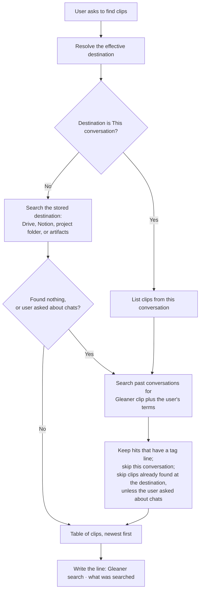

## At a glance

- **Changes:** 6
- **Files:** 5 (plus this record and its gallery copy)
- **Decisions:** 8
- **Open items:** 5

Gleaner now tags the chat it is working in. Every reply that saves, updates, or searches for a clip carries one plain line, such as `Gleaner clip · 2026-10-29 · Motion timing guidelines · Design Engineering · #motion #css`, and the "find my clips" flow searches past conversations for that line where the host can. Before, a clip kept in the conversation (Gleaner's default) could not be found from any later chat, and the skill said so.

The work is one commit on branch `claude/gleaner-chat-tagging-1cab86`, open for review as [pull request 56](https://github.com/shawn-sandy/gleaner/pull/56). Both checks pass. It is not merged, not version-bumped (auto-release does that on merge), and not live-tested on any surface.

## What changed

**1. Every save tags its chat.** Affects: everyone who saves clips. Right after the outcome sentence ("Saved …", "Here's …", "Updated …") and before the preview, the reply now carries one plain line: `Gleaner clip · <Saved date> · <clip title> · <Category> · #tag #tag #tag`. It is written the same way on every surface and for every destination, including a Fallback that drops the clip into the chat, and it never goes into the saved file or page. Where: `plugins/gleaner/skills/glean/SKILL.md`, step 7, "Tagging the chat".

**2. Searches tag the chat too.** Affects: everyone who asks "what did I save about X?". Under the result count, the reply writes `Gleaner search · <what was searched, in the user's words>`, so a search can be found again later without being mistaken for a save. Where: `glean/SKILL.md`, Clip index, step 3.

**3. Find clips searches past conversations.** Affects: Claude Code desktop users, and claude.ai users with chat search turned on. When the host offers a search over earlier conversations, Find clips searches it for `Gleaner clip` plus the user's tag, keyword, title words, or category. It does so in three cases: the effective destination is This conversation, the stored destination turns up nothing, or the user asks about chats ("which chat did I save that in?"). Hits appear in the usual table marked "(chat)", linked to the conversation where the host gives a link. Only hits with a real tag line count; the words "Gleaner clip" in a pasted follow-up prompt do not. Where: `glean/SKILL.md`, Clip index, step 1 "Past conversations" and step 3.

**4. Claude Code desktop names Gleaner conversations.** Affects: Claude Code desktop users. Where the session has a tool that sets the conversation's title, and the conversation began with a Gleaner request, the first clip saved or given in it names the conversation `Gleaner: <clip title>`, once. A coding session that saves one page keeps its own name. Where: `glean/SKILL.md`, step 7, second bullet under "Tagging the chat".

**5. Follow-up replies carry the tag line.** Affects: anyone using the follow-up skill. After it saves follow-ups to a clip, it shows glean's chat tag line along with the bookmark preview, so a follow-up chat is findable too. Where: `plugins/gleaner/skills/follow-up/SKILL.md`, "Save the follow-ups".

**6. Docs describe it.** Affects: readers of the README and the skills guide. The README's Features, destinations, Finding your clips, phrase cheat sheet, and Troubleshooting sections; the skills guide's Find section; the requirements table; and an Unreleased changelog entry. Where: `README.md`, `plugins/gleaner/skills/README.md`, `docs/requirements.md`.

## How it works now

The save side only adds one line to a reply, so it needs no picture. The find side changed shape: a second search source and a filter on its hits.

*Caption: the new path is the right-hand branch. Past conversations are a second search source, read through the tag lines only, and their hits join the same table marked "(chat)".*

## Before and after

| Rule | Before | After |
| --- | --- | --- |
| A clip kept in the chat, looked for from a later chat | Could not be found; the skill said chat clips from other conversations can't be searched | Found through its tag line where the host can search past conversations; listed as "(chat)" with a link to that conversation |
| What a save reply contains | Outcome sentence, tags, one-line TL;DR, then the preview | The same, plus one plain `Gleaner clip · …` line between the outcome and the preview |
| What a search reply contains | Count, then the table | Count, then `Gleaner search · …`, then the table |
| A save with "no preview" requested | Outcome only | Outcome plus the tag line; the line does not depend on the preview |
| Conversation title in Claude Code desktop | The app's automatic title | `Gleaner: <clip title>` after the first clip, only when the chat began with a Gleaner request, and never renamed again |
| A conversation that began with other work | Keeps its name | Still keeps its name |
| Which past-conversation hits count | Not applicable | Only hits with a tag line; a pasted follow-up prompt or a clip's own text does not count |
| A stored clip that also appears in a past chat | Not applicable | The chat hit is skipped, unless the user asked which chat |
| The current conversation in past-chat results | Not applicable | Skipped; its clips are already listed |
| Hosts without a past-conversation search | One line says chat clips from other conversations can't be searched | The same line, unchanged |
| Follow-up skill's save reply | Reply plus the bookmark preview | Reply plus the tag line and the preview |
| The clip file or page itself | Unchanged | Unchanged; the tag line never enters it |

## Decisions

1. **Tag the chat instead of keeping an index.** The default destination stores nothing, so the chat is the only place a marker can live. A plain line in the reply works on every host and needs no file, lock, or sync. Rejected: a local ledger of chat clips under the preferences folder (needs local file access, the lock protocol, and sync rules, and contradicts the skill's "the clips themselves are the index"); a new setting in the reserved `skills.gleaner` preferences namespace (a schema change for a feature that needs no setting).

2. **One plain line, identical everywhere, after the outcome and before the preview.** Plain text survives every renderer and reads the same in a transcript search. Placing it before the preview keeps it from being cut off when ChatGPT splits a long inline clip into parts. Rejected: adding it to the compact preview layout in the bookmark contract (would mean changing `bookmark.mjs` and its tests for a line that is not part of the clip); bold, code, or heading formatting (renders differently per host and adds noise to search hits).

3. **The line carries date, title, category, and tags.** A transcript search returns a snippet, not the whole message, so the line has to stand on its own as the clip's index row. Rejected: tags only (a hit could not fill the table's Date, Title, or Category columns).

4. **Two kinds: "Gleaner clip" and "Gleaner search".** The user asked for searches to be tagged as well as saves. Distinct words let a later clip search skip chats that only searched. Rejected: one marker word for both (every search chat would come back as a false clip hit).

5. **Search past conversations in three cases, not on every find.** Transcript search is slow on some hosts and redundant when the destination search already found the clip. It runs when the destination is the chat, when the stored destination finds nothing, or when the user asks about chats. Rejected: always (extra cost on every search with mostly duplicate results); never (the whole point of the change).

6. **Rename only conversations that began with a Gleaner request, once.** A rename makes Gleaner chats stand out in the Claude Code desktop sidebar, but renaming a coding session that saved one page would be wrong, and a name the user gives must stay. Rejected: rename on every save; never rename (loses the one visible tag a sidebar can show).

7. **Hits need a tag line, skip the current chat, and keep dedup unless the user asked which chat.** A fresh-context review found three gaps: every clip's follow-up prompt contains the words "Gleaner clip", so a chat that only pasted that prompt would be a hit; a transcript search can return the current session and list its clips twice; and the dedup rule dropped the chat hit exactly when the user asked which chat. All three are now explicit in the Clip index text. Rejected: leaving the heuristics to the model (the review showed it would misread them).

8. **No code changes.** The renderer helper `bookmark.mjs`, the validator, and the tests are untouched; the product of this repo is the prose the model reads. Rejected: a renderer flag for the tag line (nothing consumes it).

## Learnings

- **Four auto-release tests fail in the Claude Code sandbox for an unrelated reason.** They spawn the release script inside a temp folder under the macOS temp directory; in the sandbox the spawned process exits 0 with empty output. Pointing `TMPDIR` at a folder inside the session scratchpad makes all 81 tests pass, and the same tests are green on `main` in CI. Nothing under `scripts/` changed in this work.
- **The fixture is independent of the README.** The test copies only `scripts/` and `plugin.json` and writes its own changelog, so an `**Unreleased**` entry in the README cannot affect it.
- **"Gleaner clip" is already a phrase in every clip.** The follow-up prompt at the end of each clip and the HTML generator line both use it, so a chat search for the words alone is not enough; the rule had to require the dotted tag line.
- **In zsh, `echo =====` fails.** zsh treats a word starting with `=` as a command lookup. Quote it.
- **The app would not enable Auto-fix for this PR.** The PR was opened through a driver script, so the app could not attribute it to this session; the toggle on the PR itself still works for the user. The PR pane is also not available in this app build.

## Open items

1. **Not live-tested.** No save or search was run against the Chrome side panel, Claude Code desktop, Cowork, or ChatGPT. The maintainer does live testing; the first checks worth doing are a chat-only save followed by "which chat did I save that in?" in a new Claude Code desktop session, and a Drive save to confirm the tag line appears and the destination result still wins.
2. **Host capability wording is hedged, not verified.** The docs say claude.ai can search past chats "when its chat search is turned on" and Claude Code desktop has a transcript search. Confirm both tool names and availability in a real session and tighten or soften the README sentence in Finding your clips.
3. **Merge and release.** PR 56 is open with both checks passing and is mergeable. Auto-release will cut a patch version on merge; this is a behavior addition, so decide whether to label the PR `release:minor` before merging.
4. **Auto-fix is off.** The session could not switch it on; turn it on from the PR if you want the app to wake this session on review comments or conflicts.
5. **This record and its gallery copy are uncommitted** until someone decides whether they belong in the PR branch.

## Files touched

**Skill prose (what the model reads)**

- `plugins/gleaner/skills/glean/SKILL.md`: step 7 gains the "Tagging the chat" block (the tag line and the conversation rename); the Clip index gains the "Past conversations" source, the "(chat)" row rule, and the search tag line; the follow-up prompt rule now says a later session finds only the chat, not the file.
- `plugins/gleaner/skills/follow-up/SKILL.md`: shows glean's chat tag line with the preview after saving follow-ups.

**Docs**

- `README.md`: Features bullet, destinations note, a new paragraph under Finding your clips, a cheat-sheet phrase, a Troubleshooting row, and the Unreleased changelog entry.
- `plugins/gleaner/skills/README.md`: the Find section gains the "which chat" phrase and one sentence on tagged chats.
- `docs/requirements.md`: the This conversation row says what finding that chat later needs.

**This recap**

- `docs/plans/sessions/add-chat-tagging-session.md`: this record.
- `docs/artifacts/`: the gallery copy, filed by the save-artifact skill.

## Glossary

- **Gleaner:** the Claude Code plugin in this repo; a web clipper that saves pages, parts of pages, answers, and YouTube videos as summarized, tagged clips.
- **Clip (or glean):** one saved summary with its Source, Saved date, Category, Type, Tags, and optional Note header lines.
- **Destination:** where a clip goes: this conversation (the default), Google Drive, Notion, a Cowork project, the Claude Code project folder, or a claude.ai artifact.
- **This conversation:** the default destination; the clip is handed back as a file in the chat and stored nowhere.
- **Tag line:** the new one-line marker in a reply, `Gleaner clip · …` for saves and `Gleaner search · …` for searches.
- **Clip index:** the part of the glean skill that answers "what did I save about X?" by searching the destination and returning a table.
- **Fallback:** what happens when a save fails: the clip is given in the chat and the reply says where it was not saved.
- **Follow-up skill:** Gleaner's helper that reads a clip and saves three suggested next steps into it.
- **Follow-up prompt:** the ready-made line at the end of every clip that a user can paste into a new chat; it contains the words "Gleaner clip".
- **Past-chats search / transcript search:** a host tool that searches earlier conversations; claude.ai has one when chat search is turned on, and Claude Code desktop has one over session transcripts.
- **SKILL.md:** the Markdown instruction file for a skill; the model reads it raw at runtime, so its prose is the product.
- **Bookmark contract / bookmark.mjs:** the shared presentation rules for the preview after a save, and the optional Node helper that renders it; both unchanged here.
- **Worktree:** a separate checkout of the repo on its own branch, which is where this session worked.
- **Auto-release:** the workflow that bumps the plugin version and publishes a release whenever a merge to `main` changes the plugin; patch by default, `release:minor` or `release:major` by PR label.
- **Auto-fix:** a Claude Code desktop switch that wakes a session when its pull request gets CI failures, merge conflicts, or review comments.
- **Strict validators:** the two `claude plugin validate --strict` checks that `npm run validate` runs alongside markdownlint.
