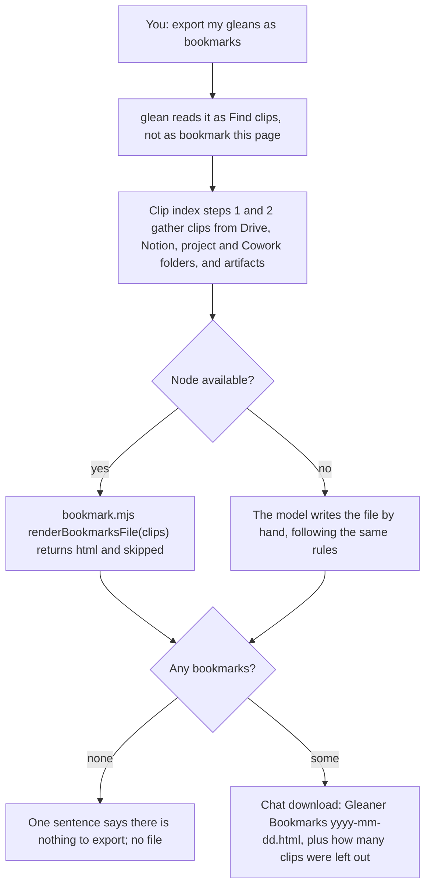
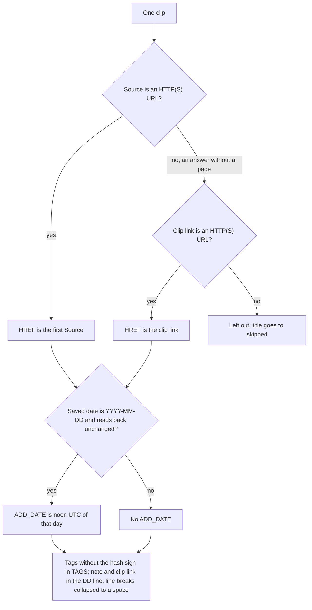

## At a glance

- **Changes:** 6
- **Files:** 5 (plus this record and its gallery copy)
- **Decisions:** 10
- **Open items:** 4

"Export my gleans as bookmarks" now hands back a browser bookmarks file of every saved clip, with one folder per category and each bookmark opening the page that was clipped. Pull request 55 (branch `claude/saved-gleans-bookmark-list-e6a0b6`, four commits, 116 lines added and 5 removed across 5 files) merged to `main` on 2026-10-29, and auto-release cut Gleaner 2.13.0 from it because the PR carried the `release:minor` label. Codex's code review finished with no findings; CodeRabbit left 3 inline review threads, all resolved before merge (the thread list was complete, not truncated). No browser import has been live-tested.

## What changed

1. **Export your gleans as a browser bookmarks file.** Affects everyone with saved clips. Say "export my gleans as bookmarks" or "make me a bookmark list" and Gleaner gathers your clips the way the Clip index does (Drive, Notion, project and Cowork folders, and artifacts), then hands back `Gleaner Bookmarks <yyyy-mm-dd>.html` as a chat download. The file is in the Netscape bookmark format that Chrome, Firefox, Safari, and Edge import: a `Gleaner` folder holds one subfolder per category. It is a snapshot, like the index sheet; importing a newer file does not update bookmarks imported earlier. Where: `plugins/gleaner/skills/glean/SKILL.md`, the Bookmarks file section after Snapshot sheet; `README.md`, Bookmarks file.
2. **Every bookmark opens the page you clipped.** Affects everyone. A bookmark's link is the clip's Source page (the first one for a multi-page clip). An answer saved without a page links to the clip itself. A clip with neither as a web link is left out and its title is returned in `skipped`, so Gleaner can say how many were left out. Where: `renderBookmarksFile` in `plugins/gleaner/skills/glean/scripts/bookmark.mjs`.
3. **The file is safe to open and import.** Affects engineers and reviewers. Titles, tags, notes, and categories come from web pages, so every one is HTML-escaped and only HTTP(S) URLs become `HREF`s. Each entry stays on one line because Chrome's importer drops an entry that spans lines. `ADD_DATE` is noon UTC on the Saved date and is left off when the date is missing, not ISO, or does not read back unchanged. Where: `escapeHtml` and `oneLine` in `bookmark.mjs`; the CLI accepts `{ clips }` input and the existing `{ bookmark, receipt }` path is unchanged.
4. **Notion clips keep their metadata.** Affects Notion users. A Notion clip stores Source, Saved, Category, Tags, and Note as database properties rather than header lines, so the Bookmarks file section maps those properties to the export fields, with the page URL as the clip link. Where: `glean/SKILL.md`, Bookmarks file section.
5. **Without Node, the model writes the same file by hand.** Affects hosts where the Node helper cannot run. The direct-generation instructions spell out the file format and the same rules: escape everything, link only HTTP(S), leave `ADD_DATE` off for a missing or invalid Saved date, and keep each link and folder heading on one line. Where: `glean/SKILL.md`, Bookmarks file section, Build it.
6. **Tests and docs.** Affects teammates and readers. Two tests in `scripts/bookmark.test.mjs`, written first and seen failing: one checks category folders, escaped text, web-only links, dates, and skipped rows (six entries, one with a line break in its title); the other checks the CLI's `{ clips }` branch. The README gains a Bookmarks file section, a contents entry, a cheat-sheet row, and an Unreleased changelog bullet; `references/bookmark.md` gains one sentence on the new CLI input. Where: `scripts/bookmark.test.mjs`, `README.md`, `plugins/gleaner/skills/glean/references/bookmark.md`.

## How it works now

The export request flows through the Clip index's existing gathering steps; only the rendering and delivery are new.



What each clip becomes. The two "no" branches are where a clip gets no date, or is left out, rather than given an invented value.



An abridged entry as the renderer writes it (one header line omitted). `1793275200` is noon UTC on 2026-10-29:

```html
<!DOCTYPE NETSCAPE-Bookmark-file-1>
<TITLE>Bookmarks</TITLE>
<H1>Bookmarks</H1>
<DL><p>
  <DT><H3>Gleaner</H3>
  <DL><p>
    <DT><H3>Design Engineering</H3>
    <DL><p>
      <DT><A HREF="https://example.com/motion-timing" ADD_DATE="1793275200" TAGS="motion,css">Motion timing guidelines</A>
      <DD>Why easing curves matter · https://drive.google.com/file/d/...
    </DL><p>
  </DL><p>
</DL><p>
```

## Before and after

| Rule | Before | After |
| --- | --- | --- |
| Asking "export my gleans as bookmarks" | No file; the Snapshot (index) sheet was the only export | A Netscape bookmarks file, `Gleaner Bookmarks <yyyy-mm-dd>.html`, delivered as a chat download |
| Asking "bookmark this page" | Saves the page as a clip | Still saves the page; a new decision rule keeps "export as bookmarks" from being read as a save |
| Which clips are gathered | Not applicable | The same stored destinations the Clip index searches: Drive, Notion, project and Cowork folders, and artifacts |
| Where a bookmark points | Not applicable | The clip's Source page, first Source for a multi-page clip; the clip itself only for an answer with no page |
| A clip with no HTTP(S) link | Not applicable | Left out and counted; Gleaner says how many |
| Saved date | Not applicable | `ADD_DATE` is noon UTC of the Saved date; left off if missing, non-ISO, or if it does not read back unchanged |
| Tags | Not applicable | In `TAGS` without the `#`; Chrome has no tags, Firefox reads them since version 43 |
| Note and clip link | Not applicable | In the `DD` description line; browsers may drop it on import |
| Line breaks in titles, categories, tags, notes | Not applicable | Collapsed to a space so Chrome's line-by-line importer keeps the entry |
| Nothing to export | Not applicable | A sentence says so; no file is delivered |
| Notion clips | Clip index step 2 reads header lines | The Bookmarks file section maps Notion database properties to the export fields; the page URL is the clip link |
| No Node available | Not applicable | The model writes the file by hand under the same rules, including no `ADD_DATE` for a bad date and one line per entry |
| Plugin version | 2.12.5 | 2.13.0, cut by auto-release because of the `release:minor` label |

## Decisions

1. **Keep the export inside the glean skill, as another way to print Clip index results.** Like the Snapshot sheet, it reuses gathering steps 1 and 2 unchanged. Rejected: a separate skill, which would duplicate the gathering steps and whose name would compete with glean's description, where "bookmarking" means saving a page.
2. **Use the Netscape bookmark format, delivered as a snapshot download.** It is the one format Chrome, Firefox, Safari, and Edge all import; a chat download matches how a This conversation clip arrives, and a snapshot matches the index sheet. Rejected: keeping imported bookmarks in sync with later changes (the README says importing a newer file does not update earlier imports). No alternative file format was recorded in the PR.
3. **A bookmark opens the clipped page; the clip itself only when there is no page.** A bookmark exists to reopen a page, and an answer about a page keeps that page as its Source. A fresh-context review found the first commit opening the clip for every answer; the second commit fixed it and made multi-page clips use their first Source. Rejected: linking every answer to the clip (the first commit's behavior).
4. **Dates are noon UTC, and a bad date means no date.** Noon keeps the day the same from UTC-12 to UTC+11. `Date.parse` silently rolls `2026-02-30` over to March 2, so a date must read back unchanged or `ADD_DATE` is left off; non-ISO dates like `9/22/2026` are left off too. Rejected: letting `Date.parse` repair a date (it invents a day); requiring `ADD_DATE` on every link in the no-Node path (CodeRabbit flagged it, and the instructions now omit it).
5. **Treat every page-derived string as untrusted and link only HTTP(S).** Titles, tags, notes, and categories come from web pages, so a title like `<script>` must not run when the file is opened directly in a browser. Clips with no web link are left out and counted so Gleaner can say how many. The tests were proven by deleting each escape and watching them fail. Rejected: hardening against hand-malformed JSON input (a `null` row, `clips` not an array), left alone because the model writes that JSON.
6. **One line per bookmark entry.** A resolved CodeRabbit thread (minor): Chrome's importer, `chrome/utility/importer/bookmark_html_reader.cc`, splits the file on newlines and drops an entry whose closing tag is on another line. Reproduced: a title "Two\nlines" in a category "Multi\r\nline" made the test count 5 entries of 6. Titles, categories, tags, and notes now have line breaks collapsed to a space (commit c3d7be7). No alternative was recorded; the fix keeps the entry rather than dropping it.
7. **Notion clips read their metadata from database properties.** A resolved CodeRabbit thread (major): Clip index step 2 reads header lines, but the Notion save stores Source, Saved, Category, Tags, and Note as properties, so Notion clips would have exported without them. The Bookmarks file section now maps those properties to the export fields, with the page URL as the clip link (commit c3d7be7). The header-based reading stays for clips that keep metadata in their body.
8. **The no-Node path follows the renderer's rules.** A resolved CodeRabbit thread with two findings (both minor): without Node, the skill told the model to give every link an `ADD_DATE` and said nothing about line breaks. The direct-generation instructions now omit `ADD_DATE` for a missing or invalid Saved date and keep each link and folder heading on one line (commit d445fec, confirmed by the bot). Rejected: letting the two paths differ, which would put invented timestamps and split entries in hand-written files.
9. **Promise only what the documentation supports, and deliver no file when there is nothing to export.** Google's help says Chrome imports this format and files it under Other bookmarks when bookmarks already exist, and Chrome has no tags; Mozilla's bug tracker shows Firefox reads `TAGS` since version 43. Nobody verified that the `DD` line survives import, so the docs say browsers may drop it. An empty export says so instead of handing over an empty file. Rejected: the first commit's wording, which promised notes and clip links survive import.
10. **Label the PR `release:minor` and decline the wording nit.** A new feature is a minor bump under auto-release, so 2.12.5 became 2.13.0. A LanguageTool suggestion to replace "leave out" with a stronger verb was declined because plain phrasal verbs are the house style for skill prose. Rejected: the default patch bump; the stronger verb.

## Learnings

A pull request records no abandoned attempts, so these are the gotchas its commit bodies and description state outright.

- **Chrome's importer reads one line at a time.** A bookmark whose closing tag lands on the next line is dropped, and the title is not reported anywhere. Reproduced with a "Two\nlines" title: the entry count fell from 6 to 5. Any field that reaches a bookmark line needs its carriage returns and line feeds collapsed.
- **`Date.parse` repairs dates silently.** `2026-02-30` becomes March 2 with no error. The renderer formats the parsed date back and compares; a mismatch means no `ADD_DATE`.
- **Escape tests must be proven by removal.** The first commit's tests passed even with the `HREF` or `TAGS` escaping deleted. The second commit's tests fail when either escape is removed, checked by deleting each one.
- **Notion clips hide their metadata in properties.** Any flow that reuses Clip index step 2 for Notion must map database properties, not header lines, or the export comes out empty.
- **Four auto-release tests fail on macOS for an unrelated reason.** `tmpdir()` sits under the `/var` symlink, so the script's run-as-main guard never matched. They pass on Linux, and pull request 54 (merged) resolved the symlink in the guard.

## Open items

1. **Live import is untested in every browser.** No one has imported a generated file into Chrome, Firefox, Safari, or Edge. The maintainer does live testing; the first checks worth doing are a Chrome import to see the `Gleaner` folder land under Other bookmarks, and a Firefox import to see whether `TAGS` appear.
2. **Whether the `DD` description line survives import is unknown.** The note and clip link ride in that line. The docs hedge with "browsers may drop it"; a live import would settle it and let the README tighten or confirm the sentence.
3. **Safari and Edge tag handling is unverified.** Only Chrome (no tags) and Firefox (reads `TAGS` since 43) are documented.
4. **Hand-malformed JSON input is deliberately unhandled.** A `null` row or a `clips` value that is not an array is not guarded in `renderBookmarksFile`, because the model writes that JSON. Pick it up only if that assumption breaks.

## Files touched

### Renderer

- `plugins/gleaner/skills/glean/scripts/bookmark.mjs`: new `renderBookmarksFile(clips)` returning `{ html, skipped }`, a `oneLine` helper that collapses line breaks, and a CLI branch for `{ clips }` input; the existing `{ bookmark, receipt }` path is unchanged.

### Skill prose (what the model reads)

- `plugins/gleaner/skills/glean/SKILL.md`: new Bookmarks file section after Snapshot sheet, an example in the Find clips intent row, a decision rule so "export as bookmarks" is not read as "bookmark this page", the Notion property mapping, and no-Node instructions that match the renderer.
- `plugins/gleaner/skills/glean/references/bookmark.md`: one sentence on the new CLI input.

### Tests

- `scripts/bookmark.test.mjs`: two tests written before the code and seen failing; the first now also checks that line breaks in a title do not split an entry, and that removing the `HREF` or `TAGS` escape fails the test.

### Docs

- `README.md`: Bookmarks file section, contents entry, cheat-sheet row, and the Unreleased changelog bullet that became the 2.13.0 entry.

### This recap

- `docs/plans/sessions/pr-55.md`: the committed record this page is rendered from.
- `docs/artifacts/`: the gallery copy, filed by the save-artifact skill.

## Glossary

- **Gleaner**: the Claude Code plugin in this repo; a web clipper that saves pages, parts of pages, answers, and YouTube videos as summarized, tagged clips.
- **Clip (or glean)**: one saved summary with its Source, Saved date, Category, Type, Tags, and optional Note.
- **Source**: the web page a clip was made from; a multi-page clip lists several.
- **Destination**: where a clip is stored: this conversation (the default), Google Drive, Notion, a Cowork project, the Claude Code project folder, or a claude.ai artifact.
- **This conversation**: the default destination; the clip is handed back as a file in the chat and stored nowhere.
- **Clip index**: the part of the glean skill that answers "what did I save about X?" by gathering clips from the stored destinations (steps 1 and 2) and printing a table.
- **Snapshot sheet (index sheet)**: the Clip index's existing export, a one-time sheet of saved clips that does not update later.
- **Netscape bookmark file**: the plain HTML layout that browsers have used to import and export bookmarks since the 1990s; folders are `H3` headings, bookmarks are `A` links inside `DL` lists.
- **HREF**: the web address a bookmark opens.
- **ADD_DATE**: the bookmark's creation time, as a count of seconds since 1970 (a Unix timestamp).
- **TAGS**: a comma-separated list of tags on a bookmark; Firefox reads it, Chrome ignores it.
- **DD description line**: the optional line under a bookmark that carries a description; here it holds the note and the clip's link or path.
- **HTML-escaping**: replacing characters like `<` and `"` with safe codes so text from a web page cannot act as markup or script.
- **HTTP(S) URL**: a web address starting with `http://` or `https://`; the only kind the export links to.
- **bookmark.mjs**: the optional Node helper that renders Gleaner's previews, and now the bookmarks file, from JSON input.
- **renderBookmarksFile**: the new function in `bookmark.mjs` that turns clip rows into the file and reports which clips it left out.
- **skipped**: the list of clip titles the renderer left out because they had no web link to open.
- **No-Node fallback (direct generation)**: the instructions the model follows to write the file itself when the Node helper is unavailable.
- **SKILL.md**: the Markdown instruction file for a skill; the model reads it raw at runtime, so its prose is the product.
- **Round-trip (date)**: parsing a date and formatting it back; if the text changes, the date was invalid.
- **Noon UTC**: 12:00 in Coordinated Universal Time, chosen so the calendar day is the same in nearly every time zone.
- **Fresh-context review**: a code review run by a separate session with no memory of writing the code.
- **CodeRabbit, Codex**: the two review bots on this repo's pull requests; a review thread is resolved when its finding has been fixed or declined.
- **release:minor, auto-release**: the PR label and the workflow that bumps the plugin version and publishes a release on every merge to main that changes the plugin; patch by default, minor or major by label.
- **Worktree**: a separate checkout of the repo on its own branch, where this recap was written.
