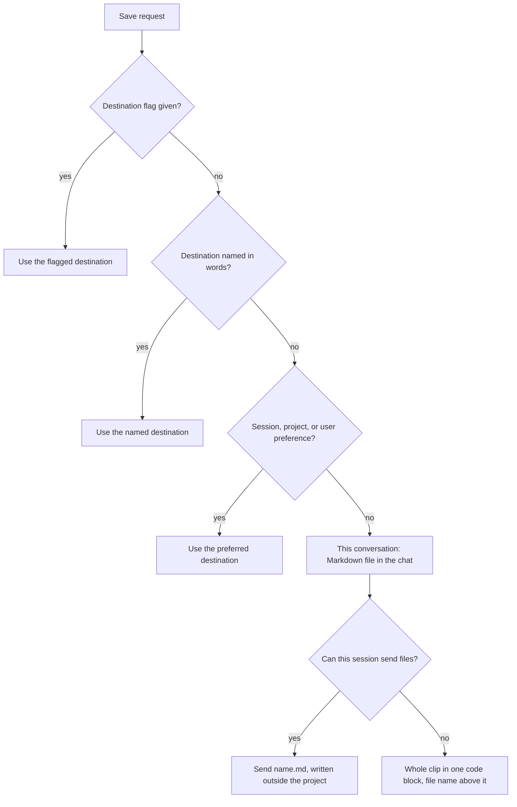

## At a glance

- **Changes:** 8
- **Files:** 10 (plus this record and its gallery copy)
- **Decisions:** 8
- **Open items:** 5

Gleaner now hands every clip back as a Markdown file in the chat when no destination is set, on every surface: the Chrome side panel, ChatGPT, Claude Code, and Cowork. Before, the default was Google Drive in the side panel and ChatGPT, the project folder in Claude Code, and the open project in Cowork. The work is on branch `claude/clip-storage-no-external-acb654` and open for review as a pull request. It is not merged, not version-bumped, and not live-tested.

The session started with a question: where do clips go when there is no external storage? The answer led to a request to make the chat file the default everywhere. A fresh review before the pull request found a stale default in the preferences contract and a setup prompt that would have returned every session; both are fixed.

## What changed

### Clips come back in the chat by default

- **Who it affects:** every user who has not set a default destination.
- **What is different:** with no saved preference, Gleaner gives the clip as a Markdown file in the conversation. It stores nothing unless the user names a destination.
- **How to reach it:** say "save this page" with no preferences set. Glean step 2 and the new "This conversation" section of step 6 in `plugins/gleaner/skills/glean/SKILL.md`.

### A flag and phrases to pick the chat on purpose

- **Who it affects:** users whose saved default is somewhere else.
- **What is different:** `--to chat`, "just give me the file", "in the chat", or "don't save it anywhere" pick the conversation for one save.
- **How to reach it:** `save this page --to chat`, or `/gleaner:glean --to chat`.

### Store a chat clip after the fact

- **Who it affects:** users who decide to keep a clip after seeing it.
- **What is different:** right after a clip comes back in the chat, "save it to Drive" (or "save it to this project" in Claude Code and Cowork, or just a `--to` flag) stores that same clip, parts and answers included, as a new clip.
- **How to reach it:** the "Storing a chat clip" rule under Clips saved this session in glean SKILL.md.

### Cowork stops saving into the open project on its own

- **Who it affects:** Cowork users.
- **What is different:** working inside a Cowork project no longer makes it the destination. Saying "this project" still saves there.
- **How to reach it:** "save it to this project" inside Cowork.

### "Save it as a Google Doc" means Drive everywhere

- **Who it affects:** users on any surface who ask for a Google Doc.
- **What is different:** that phrase, and "put it in Browser Research", now pick Drive on every surface. Before, only Claude Code had this rule: Drive was already the default in the side panel and ChatGPT, and Cowork saved to the open project.
- **How to reach it:** "save it as a Google Doc".

### Search and the duplicate check handle chat clips

- **Who it affects:** users who search their clips or re-save a page.
- **What is different:** a chat clip isn't stored, so the duplicate check skips it. With nothing set, "what did I save about X" lists the clips given earlier in this conversation, says chat clips from other conversations can't be searched, and asks which stored location to search too.
- **How to reach it:** the Clip index section and the duplicate check in glean step 2.

### No setup prompt on the first save

- **Who it affects:** first-time users, and any skill that adopts the shared preferences.
- **What is different:** when a skill's default isn't a destination the preferences file can store, the first save skips the setup prompt and mentions setup once per session. `/gleaner:preferences setup` still sets a stored default.
- **How to reach it:** the setup paragraph in `plugins/gleaner/skills/preferences/references/contract.md`.

### Follow-ups can read and update a clip from the chat

- **Who it affects:** users of `/gleaner:follow-up`.
- **What is different:** a clip given in this conversation is read from the conversation, then updated by giving the file again. The reply says the clip isn't stored instead of "Saved to".
- **How to reach it:** "what should I follow up on?" right after a chat save.

## How it works now

How Gleaner picks a destination for a save. The only change is the last box: with nothing set, the clip now goes to the chat instead of Drive, the project folder, or the open Cowork project.

How a chat clip reaches the user. An attached file when the session can attach one, otherwise one code block. Both stay in the chat only.

## Before and after

| Rule | Before | After |
| --- | --- | --- |
| Default with nothing set, Chrome side panel and ChatGPT | Google Drive, `Browser Research/<Category>/` | Markdown file in the chat |
| Default with nothing set, Claude Code | `browser-research/<category>/` in the project | Markdown file in the chat |
| Default with nothing set, inside a Cowork project | That Cowork project's folder | Markdown file in the chat |
| Choosing the chat on purpose | Not possible; it was only the backup | `--to chat` or "just give me the file" |
| Keeping a chat clip after seeing it | Not possible | "save it to Drive" stores the same clip |
| "Save it as a Google Doc" | Drive (a rule only Claude Code had) | Drive on every surface |
| A destination can't be reached | Hand over the Markdown file, say where it was not saved | Same, now named as the "This conversation" destination |
| Duplicate-page check | Searches the default destination | Skipped for chat clips |
| "What did I save about X?" with nothing set | Searches the surface's default | Lists this conversation's clips, asks which stored location to search |
| First save with nothing set | Setup prompt suggesting the surface's destination | No prompt; setup mentioned once per session |
| Updating a clip saved this session | Replace it where it was saved | For a chat clip, give the whole file again under the same name |

## Decisions

### Make the chat file the default on every surface

- **Chosen:** the chat file is the default in the Chrome side panel, ChatGPT, Claude Code, and Cowork.
- **Why:** the user asked for one default everywhere, including Claude Code and Cowork.
- **Rejected:** chat default only for the side panel and ChatGPT, keeping Claude Code on the project folder. Claude recommended this, because Claude Code had saved to the project folder since 1.2.0. The user chose every surface instead.

### Turn the old fallback into a named destination

- **Chosen:** "This conversation" is a destination like Drive or Notion, and the fallback now points at it.
- **Why:** the behavior already existed as the fallback ("give the user the Markdown file"). Naming it gives one place to describe how a chat clip is delivered and updated.
- **Rejected:** a separate new save path next to the fallback. That would describe the same thing twice.

### Do not add a "conversation" preference type yet

- **Chosen:** the chat default applies only when nothing is set. It cannot be saved as a preference.
- **Why:** the preferences file accepts only `drive`, `notion`, `cowork`, `local`, or `artifact`, and `scripts/validate-skills.mjs` enforces that list. Each saved destination also needs a folder path or a remote ID, and a chat has neither. Adding a type means changing the contract, the validator, and the tests.
- **Rejected:** adding a `conversation` provider now. It costs a schema change for a need nobody has hit yet.

### Skip the first-save setup prompt while the default is the chat

- **Chosen:** when a skill's default isn't a stored provider, the first save skips the setup prompt and mentions setup once per session.
- **Why:** the review found that accepting the setup suggestion ("leave the destination unset") stores nothing. The next session would still be unconfigured, so the prompt would come back on every session's first save.
- **Rejected:** suggesting "leave the destination unset" in the prompt (the first version on this branch), because of that loop. Adding a `conversation` provider would also end the loop, but it stays deferred (see above).

### Name the flag `--to chat`

- **Chosen:** `--to chat`.
- **Why:** short, and it matches how people say it ("in the chat").
- **Rejected:** `--to conversation`, which is longer to type.

### Attach a real file when possible, else one code block

- **Chosen:** if the session can attach a downloadable file to its reply, write `<name>.md` outside the project and attach it. Otherwise put the whole clip in one code block, with the file name above it and a fence longer than any code block inside the clip. A file the user can't see from the chat doesn't count.
- **Why:** a real file is easiest to keep, but not every surface can attach one. A code block works everywhere.
- **Rejected:** always a code block, which loses the download where one is possible. Also rejected: writing the file into `browser-research/`, which puts files in the repo, the thing this change stops.

### Ask where else to search when no stored destination is set

- **Chosen:** with no preference, a search lists this conversation's clips, says chat clips from other conversations can't be searched, and asks which stored location to search.
- **Why:** there is no single place to look any more, and guessing could miss clips.
- **Rejected:** automatically searching the old defaults (Drive and `browser-research/`). That adds rules and still guesses.

### Leave the version bump to /release

- **Chosen:** an **Unreleased** changelog entry only. The version stays 2.5.0.
- **Why:** the project's CLAUDE.md says to cut versions with `/release`, which bumps, dates the entry, validates, and commits.
- **Rejected:** editing `plugin.json`'s version by hand.

## Learnings

- **The chat file was never the default.** Git history shows Gleaner 1.0.0 (`a72b8b4`) already defaulted to Google Drive. Handing over the Markdown file was always the fallback for when Drive could not be reached. Users who mostly saw chat files probably had no Drive connector at the time.
- **A fresh review caught what my own search missed.** My leftover-default search looked for phrases like "default in". The preferences contract listed the old defaults in a sentence without those words ("current Cowork project when present, current project in Claude Code, otherwise Drive's Browser Research"), so it slipped through until a reviewer who read the whole file found it.
- **zsh is not bash.** `${PIPESTATUS[0]}` prints nothing in zsh, where the array is lowercase and starts at 1 (`${pipestatus[1]}`). Rerunning the command without a pipe was the reliable way to read its exit code. A bare `echo ===SK` also fails in zsh, because a word starting with `=` is treated as a command lookup.
- **One edit covered two skills.** The youtube skill runs glean step 2 to pick its destination, so changing glean's default changed video saves too. Only the youtube `argument-hint` needed its own edit.
- **The glean description is almost full.** It is now 1,003 of the validator's 1,024-character limit. The next destination added there needs shorter wording.

## Open items

- **Not live-tested.** Nothing has been tried in the Chrome side panel, ChatGPT, Claude Code, or Cowork. It is unknown whether each surface attaches a real `.md` file or falls back to a code block. The project's CLAUDE.md says the maintainer does live testing. `docs/chatgpt-marketplace.md` now has a checklist line for it.
- **Version not bumped.** Run `/release minor` to move to 2.6.0 and date the Unreleased entry.
- **Not merged.** The work is open for review as a pull request from `claude/clip-storage-no-external-acb654` into `main`.
- **No stored "conversation" preference.** To let users save the chat as their default (for example to override a Drive default for one project), add a `conversation` provider to `contract.md`, accept it in `scripts/validate-skills.mjs` with no path or remote ID, and add tests.
- **"Here" has no destination outside a project.** "Save it here" maps to This project, which exists only in Claude Code and Cowork. In the side panel and ChatGPT it may now be read as "in the chat". This ambiguity partly predates this branch.

## Files touched

**Skills (the behavior)**
- `plugins/gleaner/skills/glean/SKILL.md`: adds the "This conversation" destination, `--to chat`, the new default in step 2, storing a chat clip after the fact, how chat clips are given and updated, the fallback pointer, and the search rule.
- `plugins/gleaner/skills/youtube/SKILL.md`: adds `chat` to the `argument-hint`.
- `plugins/gleaner/skills/follow-up/SKILL.md`: reads a clip given in the conversation from the conversation, and replies without claiming a save.
- `plugins/gleaner/skills/preferences/references/contract.md`: replaces the stale list of old defaults, and skips the first-save setup prompt when the default is not a stored type.

**Manifests (the descriptions)**
- `.claude-plugin/marketplace.json`: plugin description names the chat default.
- `plugins/gleaner/.claude-plugin/plugin.json`: plugin description names the chat default.

**Docs**
- `README.md`: intro, example, features, requirements, quick start, shared preferences, destinations table, the Claude Code notes, flag table, cheat sheet, duplicate-check note, troubleshooting row, and the Unreleased changelog entry.
- `plugins/gleaner/skills/README.md`: the setup paragraph and the "Before you start" destination line.
- `docs/chatgpt-marketplace.md`: a manual test line for the chat default.
- `docs/preferences-testing.md`: the first-save scenario now expects no setup prompt.

## Glossary

- **Gleaner:** this Claude plugin. It saves web pages, parts of them, and YouTube videos as summarized, tagged notes.
- **Clip (or glean):** one saved note: a Markdown summary with Source, Saved, Category, Type, and Tags lines at the top.
- **Destination:** where a clip goes: the conversation, Google Drive, Notion, a Cowork project, the Claude Code project, a local path, or a claude.ai artifact.
- **Surface:** the place Gleaner runs: the Chrome side panel, Claude Code desktop's built-in browser, Cowork, or ChatGPT.
- **Chrome side panel:** the Claude panel inside Google Chrome.
- **Cowork:** the Claude desktop app's project workspace, with a folder on the user's computer.
- **Claude Code:** Anthropic's coding tool. Here, "This project" means the folder its session works in.
- **`--to` flag:** a word added to a request (`--to drive`, `--to chat`) that sets the destination for that one save.
- **Preferences / shared contract:** saved defaults for destination and format, with the rules in `contract.md`. Other skills can use them too.
- **Provider:** a destination type the preferences file can store: drive, notion, cowork, local, or artifact.
- **Fallback:** what Gleaner does when a destination can't be reached. It now gives the clip in the conversation.
- **Duplicate check:** before saving a page, Gleaner looks for an earlier clip of the same URL and asks before saving another.
- **Clip index:** Gleaner's search over saved clips ("what did I save about X?").
- **Artifact:** a private web page on claude.ai. One of Gleaner's destinations.
- **SKILL.md:** the instruction file a skill's model reads as plain text when it runs. Here it is the product itself.
- **Unreleased:** the changelog heading for changes not yet in a version. `/release` turns it into a numbered entry.
- **`/release`:** the project's command that bumps the version, dates the changelog, runs the checks, and commits.
- **Scratchpad:** a temporary folder for the session, outside the project.
- **Code fence:** the run of backticks that opens and closes a Markdown code block. A longer outer fence keeps inner code blocks from closing it early.
- **Strict validators:** `claude plugin validate --strict`, run on the marketplace and the plugin by `npm run validate`.
